# Underwriting & Policy Lifecycle

This page walks a policy from lead to claim and names the router that owns each step. All routes are under `/tenants/{tenant_id}` and reach the Tenant Service through the API Gateway.

```mermaid
flowchart LR
    L[Lead / Customer] --> Q[Quote]
    Q --> C[Underwriting Case]
    C --> G[Pre-underwriting gates]
    G --> R[Requirements Engine]
    R --> AI[AI risk assessment]
    AI --> PU[Post-underwriting<br/>counter-offer · reinsurance]
    PU --> A[Stage A<br/>pre-issuance]
    A --> I[Issue + first premium]
    I --> B[Stage B<br/>in-force servicing]
    B --> CL[Claims]
```

## 1. Leads, groups and quotes

| Step | Where | Notes |
|---|---|---|
| Individual customer | `customers.py` | Per-tenant CNIC uniqueness; publishes `CustomerCreated` → gateway `quote_worker` prices every eligible plan |
| Family group | `families.py` | Floater and life-bundle family policies; member validate → confirm |
| Corporate group | `organizations.py` | Master policies and employee census validate → confirm (group life) |
| Products | `insurance_plans.py` | Per-tenant plan catalogue and rate tables (`POST /insurance-plans/seed-defaults` loads the standard set) |
| Lead sources | `acquisition_sources.py` | |
| Instant quote | Gateway `POST /quote`, `GET/PATCH /quotes` | Deterministic, `shared/pricing/calculator.py`; no LLM |
| Plan suggestion | Gateway `POST /suggest-plan` | LLM recommendation via Risk Engine |

## 2. Pre-underwriting gates

A case collects six clearance gates before AI underwriting:

| Gate | Router | Summary |
|---|---|---|
| **E-Application** | `e_application.py` | Customer's own medical/lifestyle/family-history/existing-insurance disclosure and signed declaration, via a single-use hashed expiring link (`/public/e-application/{token}`, no login). Staff: `invite`, `verify`, `custom-questions`. Submitting publishes a live [case event](/data-flow#live-case-events-sse). |
| **Agent's Confidential Report** | `agent_confidential_report.py` | Selling agent's moral-hazard, financial-standing and lifestyle observations (`GET/PUT /acr`, `/acr/submit`) |
| **PEP / sanctions compliance** | `cases.py` `POST /cases/{id}/compliance/run` | Screening (OpenSanctions when `OPENSANCTIONS_API_KEY` is set) |
| **Initial Premium Payment** | `initial_premium_payment.py` | "No premium, no risk" (Insurance Ordinance 2000 s.30) — first premium collected at proposal, priced from the case's `PremiumQuote` (mock payment gateway) |
| **Insurance history** | `insurance_history.py` | Over-insurance against Human Life Value, replacement/churning, non-disclosure; underwriter `clear`/`fail` override |
| **Medical exam** | `medical_exam.py` | Above the Non-Medical Limit: `assess` resolves the test panel and budget, `invite` issues a booking link (`/public/medical-exam/{token}`), customer or staff books a panel clinic slot, then `result` or `waive` |

## 3. Requirements Engine → AI underwriting

`POST /cases/{id}/requirements/determine` (`shared/underwriting/requirements_rules.py`) computes the case's mandatory requirements from age, coverage, coverage-to-income, smoker status, BMI and declared conditions. If any required item is not `Satisfied`/`Waived`, the case moves to `Pending Documents` and the Risk Engine is **never called**. Otherwise the gateway fetches the evidence bundle (`/underwriting/evidence`) and runs the [LangGraph workflow](/data-flow#langgraph-workflow-risk-engine-internals). Details: [Case Management](/cases#requirements-engine--caseworkflow).

## 4. Post-underwriting

| Step | Router | Summary |
|---|---|---|
| Counter-offer | `pre_issuance.py` `/policies/{pid}/counter-offer` (+ `accept` / `decline`) | Revised terms (e.g. loading) the customer must accept |
| Facultative reinsurance | `reinsurance.py` | Split sum assured into retained / treaty / facultative; `refer` parks the policy at `ReinsurerReferred`; `response` records terms; `apply` writes them onto the contract; `withdraw` |

## 5. Stage A — pre-issuance

`GET /policies/{pid}/pre-issuance` returns a six-step readiness checklist, and `POST /policies/{pid}/issue` hard-gates on the same rules:

1. Accept revised terms (counter-offer)
2. Clear requirements — `/policies/{pid}/requirements`, `/requirements/{id}/{submit,verify,waive}`
3. Collect first premium — `policies.py` `/payments/initiate` → `/payments/confirm`
4. Compliance — `/policies/{pid}/compliance/run`, `/compliance/{id}/{clear,fail}`
5. Beneficiaries — `PUT /beneficiaries` (shares must total 100), with history
6. Documents — `/documents/generate` (real PDFs), download

`GET /policies/{pid}/issuance-preview` gathers everything the issuance review screen needs in one call.

## 6. Stage B — in-force servicing (`post_issuance.py`)

| Area | Routes |
|---|---|
| Free-look | `GET /free-look`, `POST /free-look/cancel` (full refund while the window is open; clock anchored on delivery) |
| Onboarding | `/onboarding/{policyholder-id, welcome-kit, portal, contact, send-welcome, acknowledge}` |
| Premiums | `/premiums` schedule, `collect`, `bulk-collect`, `remind`, `waive`, `monitor`, `autopay`, `restructure`, `lapse-warning`, reminders and receipts |
| Endorsements | `/endorsements/{nominees, address, sum-assured, riders, contact}`, `quote`, document download, email |
| Renewal / exit | `policies.py` `/renew`, `/lapse`, `/cancel`, `GET /policies/renewals/upcoming` |

### Reinstatement (`reinstatement.py`)

Revives a `Lapsed` policy. It is **not** a new issuance — the original policy number and history are kept and a `PolicyReinstatement` case (`RN-YYYY-NNNNN`) is attached, with its own workflow, evidence, arrears, underwriting decision, payment and audit trail. Paying the overdue premium never reinstates on its own; underwriting must approve.

| Step | Route (under `/tenants/{t}/policies/{p}/reinstatement`) |
|---|---|
| 1 Detect + eligibility | `GET ""` — live checks: status, contract running, product window, no open/settled claim, no surrender, no duplicate case |
| 2 Request | `POST ""` — re-validates eligibility; an open case is resumed, never duplicated |
| 3 Arrears | `POST /{id}/arrears/recalculate` — unpaid premiums + late surcharge + optional interest/fee |
| 4 Declaration + documents | `POST /{id}/declaration`, `POST /{id}/evidence/{key}` (file or note), `GET .../download` |
| 5 Assessment | `POST /{id}/assessment` — lapse length, declared changes, sum assured vs Non-Medical Limit; a recommendation only |
| 6 Decision | `POST /{id}/decision` (Underwriter / Admin / SuperAdmin) — Approve · ApproveWithTerms · RequestEvidence · Decline; `POST /{id}/terms/respond` |
| 7 Payment | `POST /{id}/payment` — funds are held against the case; the premium ledger is not touched yet |
| 8 Restore | `POST /{id}/restore` — re-checks every gate, settles the arrears + receipts, appends a `Reinstatement` `PolicyVersion`, `Lapsed → Active` |
| 9 Confirmation | `GET /{id}/confirmation/download`, `POST /{id}/confirmation/send` |
| — | `POST /{id}/withdraw` — closes the case; refunds any held funds |

Cover is effective from the restore date; there is no cover for the lapse period. Rules are per product in `services/insurer_config.py` (`REINSTATEMENT_DEFAULT_RULES`, `REINSTATEMENT_PRODUCT_RULES`): window, declaration-only band, medical-evidence trigger, interest, fee and maximum loading. **All defaults are placeholders** — Adamjee publishes the process but no universal revival period. Every action writes a `PolicyEvent` carrying the `case_no`; the engine (`services/reinstatement_engine.py`) is pure and unit-tested (`test_reinstatement_engine.py`).

### Renewals (`renewals.py`)

Two different processes that are never mixed. **Premium Renewal** collects the next scheduled premium of a policy that simply continues (Individual, Family) — paying year 2 of a 20-year policy does not renew the contract, and risk evaluation / acceptance are skipped. **Contract Renewal** renews cover for another term (products flagged `contract_renewable`): it needs a risk evaluation (straight-through rules or an underwriter referral) and the customer's acceptance, and binds a new `PolicyVersion` N.0 + `RenewalTransaction`. Group Life renews at master-policy level (`group_renewals.py`); a group certificate's panel only points there. A cycle is a Contract Renewal only when the product is contract-renewable **and** its due date falls on/after the end of the current contractual period.

Issuance builds only the first policy-year ledger, so the engine (`services/renewal_engine.py`) plans each later cycle from the ledger (an unpaid row, else the next date on the policy's own frequency grid, stopping at maturity) and creates the instalment row when the cycle is opened. One `PolicyRenewal` case (`RW-YYYY-NNNNN`) per cycle; payment goes through the same `collect_installment` as Step 3, so receipts, commission and grace revival are identical and a payment taken in either place is seen by both.

| Step | Route (under `/tenants/{t}/policies/{p}/renewals`) |
|---|---|
| 1–2 Identify + eligibility | `GET ""` (next due date, premium, type, live eligibility, processing tracker) · `POST ""` opens the cycle |
| 3 Notice | `POST /{id}/notice` (Email · SMS · WhatsApp · Letter; logged with the Step 3 reminders) · `GET /{id}/notice/download` |
| 4 Risk | `POST /{id}/risk/evaluate` · `POST /{id}/risk/decision` (Underwriter / Admin) — Approve · ApproveWithLoading · Decline |
| 5 Acceptance | `POST /{id}/acceptance` |
| 6 Collect + reconcile | `POST /{id}/payment` · `POST /{id}/reconcile` (ledger, one receipt, amount, reference, policy state, commission; a failed blocking check needs a signed-off note) |
| 7–8 Complete + documents | `POST /{id}/complete` · `GET /{id}/confirmation/download` · `POST /{id}/confirmation/send` · `POST /{id}/cancel` |
| Portfolio | `POST /tenants/{t}/renewals/sweep` (Admin; `dry_run`, `send_notices`) — the on-demand equivalent of the daily job |

Rules are per product in `services/insurer_config.py` (`RENEWAL_DEFAULT_RULES`, `RENEWAL_PRODUCT_RULES`): `contract_renewable`, notice days (30), max renewal age, reassessment age, STP claim limit. **No product is contract-renewable by default** — Adamjee does not publish the list — and all numbers are placeholders. The background scheduler (`renewal_scheduler.py`) remains disabled; the sweep replaces it on demand.

### Claims Management (`claim_workflow.py`)

A policy-scoped workspace over the **same `Claim` records** the claims register uses — one truth for the register, dashboard, reinsurance recovery and group claims. `ClaimProcess` (one row per claim) adds the 7-step workflow data, and every status change goes through the register's `VALID_TRANSITIONS` with a `ClaimStatusHistory` row. **Claims are independent of Reinstatement and Renewals:** eligibility asks whether cover was in force on the **event date**, rebuilt from the policy's audit trail (`coverage_timeline`; a lapse takes effect at the end of the grace window, recorded in the `PolicyLapsed` event as `grace_until`), never what the status is today — a lapsed or cancelled policy can still owe a valid claim.

Claim types: Death, Accidental Death (rider), Disability (rider, % of the rider sum assured), Hospitalization / Reimbursement (health products or a hospital rider; admissible expenses less co-pay, within the remaining annual limit). A claim is always *registered*; whether it is payable is decided in step 2.

| Step | Route (under `/tenants/{t}/policies/{p}/claims-management`) |
|---|---|
| Overview | `GET ""` — cover periods, benefit menu, the policy's claims · `GET /{id}` full workspace · `POST /{id}/adopt` brings a register-created claim into the workflow |
| 1 Intimation | `POST ""` — claimant, covered person, event; eligibility runs immediately |
| 2 Eligibility | `POST /{id}/eligibility/verify` · `/eligibility/override` (manager, reason ≥ 15 chars). Checks: cover on the event date, term, renewed period, benefit/rider on the event date, insured person, cause, prior death benefit; review points: contestability (also restarted by a reinstatement), suicide exclusion, waiting period, late report, duplicate |
| 3 Documents | `POST /{id}/documents/{key}` (file → stored as a claim `Artifact`) · `/waive` (manager) · `/reject` (stops the clock) · `POST /documents` (ask for more) · `GET /{id}/checklist/download`. Checklist depends on type, individual vs group form, illness vs accident, claimant being the nominee, contestability |
| 4 Investigation & assessment | `POST /{id}/investigation/finding`, `/investigation/complete` (required when a high red flag is raised) · `POST /{id}/assessment` — contractual benefit, never above the amount claimed |
| 5 Decision | `POST /{id}/decision` — Approve · PartialApprove · Reject · RequestInfo · Refer. Above `CLAIM_MANAGER_LIMIT` (PKR 500,000, the register's own threshold) or once referred only a ClaimsManager/Admin may decide. The 5–7 working-day clock starts when the last required document arrives and pauses when more is requested |
| 6 Settlement | `POST /{id}/settlement/payees` (CNIC, IBAN, account title; minors paid via the guardian) · `/authorize` · `/disburse` (the register's own `settle_claim_with_payouts`) · `/reconcile` (a failed blocking check needs a note) |
| 7 Closure | `POST /{id}/close` — a paid death benefit ends the policy (`Lapsed/Active → Cancelled`, unpaid instalments waived), a paid rider benefit reduces or exhausts the rider, a hospital benefit reduces the annual limit · `GET/POST /{id}/confirmation/...` (letter PDF + email) |

Checklists, waiting periods, contestability, early-claim and suicide-exclusion windows and the benefit formulas are **configurable placeholders** in `services/insurer_config.py` (`CLAIM_*`) — Adamjee publishes the process and the forms, not the exact wording. The engine (`services/claim_engine.py`) is pure and unit-tested (`test_claim_engine.py`).

### Policy Maturity & Exit (`policy_exit.py`)

The end of a policy's life. Four exits, plus one read-only closure:

| Exit | When | Result |
|---|---|---|
| **Maturity** | a savings / investment-linked policy reaches maturity | proceeds settled → `Matured` |
| **Expiry** | a protection-only term ends | closed without a payout → `Expired` |
| **Surrender** | the policyholder leaves early (savings products, after `surrender_min_years`) | net surrender value settled → `Surrendered` |
| **CorporateExpiry** | a group certificate whose master policy ended and was not renewed | cover closed → `Expired` |
| **DeathClaimClosure** | the policy a paid death claim already ended | closure confirmed and archived (status stays `Cancelled`) — the benefit itself is Claims Management's |

An approved extension is a **Renewals** matter: an open renewal case (or an in-progress group renewal) blocks closing, and where a product permits an extension the case must record that the policyholder declined it or send it to Renewals. An open claim, or an open reinstatement, blocks the exit too; a free-look cancellation is pointed to instead of a surrender.

| Step | Route (under `/tenants/{t}/policies/{p}/exit`) |
|---|---|
| 1 Identify upcoming | `GET ""` (natural exit, timing window, indicative maturity / surrender value) · `POST /tenants/{t}/exits/sweep` (Admin, `dry_run`) |
| 2 Renewal / extension | `POST /{id}/extension` — declined, or redirected to Renewals |
| 3 Eligibility & financials | `POST ""` opens it (a surrender is requested with `exit_type: "Surrender"` + a reason; a `SurrenderRequested` event then blocks reinstatement) · `POST /{id}/eligibility/verify` · `POST /loans` (manager) |
| 4 Documents & consent | `POST /{id}/documents/{key}` (+ `/waive`) · `POST /{id}/consent` — every declaration, who gave it, how |
| 5 Final settlement | `POST /{id}/settlement/calculate` · `GET /statement` (PDF) · `POST /accept` (accept or decline; the figure expires after `quote_valid_days`) |
| 6 Authorize & disburse | `POST /settlement/payee` (the policyholder only: CNIC matched to the one on record, IBAN, account title) · `/authorize` (manager; **above `dual_control_limit` the authoriser must differ from the calculator**, SuperAdmin exempt) · `/disburse` · `/reconcile` |
| 7 Close & archive | `POST /{id}/close` — final status, cover ended (the maturity date, the master policy's expiry, or today for a surrender), future instalments waived, autopay off, riders ended, loans recovered; `GET/POST /{id}/confirmation/...` (letter + email) |

**Settlement.** Maturity pays the fund value at maturity (optionally floored at a guaranteed % of sum assured); surrender pays the fund × the surrender factor for the completed years. Deductions — loans (principal + simple interest), premium unpaid and due, other recoverable amounts — and tax then come off to give the net. **The fund value, surrender-factor schedule, guarantee and withholding rate are configurable placeholders** (`EXIT_*` in `services/insurer_config.py`): Adamjee states that a unit-linked plan's maturity value is its cash value less indebtedness and recoverable amounts, but publishes neither the unit prices nor the charges. Replace `exit_engine.fund_value()` with the real unit-price feed. There is no loan module yet, so loans are recorded through `POST /exit/loans`. The engine (`services/exit_engine.py`) is pure and unit-tested (`test_exit_engine.py`).

## Policy state machine

Every status change goes through `shared/services/policy_state_machine.apply_transition()`, which rejects illegal moves (`IllegalStateTransition`) and appends an immutable `PolicyEvent` (the audit trail, `GET /policies/{pid}/events`). After commit, routers publish a `PolicyLifecycleEvent` to `insurance.policy.lifecycle.v1`.

| From | Allowed next states |
|---|---|
| `Quoted` | Proposed, InformationRequested, Declined |
| `Proposed` | UnderReview, InformationRequested, CounterOffer, Approved, AcceptedWithLoadings, Declined, Quoted |
| `UnderReview` | InformationRequested, CounterOffer, Approved, AcceptedWithLoadings, Declined, Postponed, ReinsurerReferred, Proposed |
| `InformationRequested` | Proposed, UnderReview, CounterOffer, Approved, AcceptedWithLoadings, ReinsurerReferred, Declined |
| `ReinsurerReferred` | Approved, AcceptedWithLoadings, CounterOffer, Postponed, Declined, UnderReview |
| `Postponed` | UnderReview, Declined |
| `CounterOffer` | Approved, AcceptedWithLoadings, NotTakenUp, Declined |
| `Approved` | PendingPayment, Issued, CounterOffer, ReinsurerReferred, Declined, Cancelled |
| `AcceptedWithLoadings` | PendingPayment, Approved, Issued, CounterOffer, ReinsurerReferred, Declined, Cancelled |
| `Issued` | PendingPayment, Active, Cancelled |
| `PendingPayment` | Active, Cancelled, NotTakenUp |
| `Active` | Active (renewal), GracePeriod, Lapsed, Cancelled, Matured, Surrendered, Expired |
| `GracePeriod` | Active, Lapsed, Cancelled, Matured, Surrendered, Expired |
| `Lapsed` | Active (reinstatement), Cancelled (a paid death claim ends the policy), Expired (a lapsed term still reaches its end) |
| `Matured` · `Surrendered` · `Expired` | *(terminal — final states of Maturity & Exit)* |
| `Declined` | UnderReview, Approved, AcceptedWithLoadings (underwriter override) |

The grace period length comes from `GRACE_PERIOD_DAYS` (default 30).

## 7. Claims (`claims.py`)

FNOL → triage → investigation → adjudication → payout, with reinsurance recovery and contestability re-underwriting.

| Route | Purpose |
|---|---|
| `POST/GET /claims`, `GET /claims/{id}` | Register (FNOL) and list |
| `PATCH /claims/{id}/status` | Status transitions |
| `POST /claims/{id}/adjudicate` | Rule-engine adjudication |
| `POST /claims/{id}/payout` | Disbursement |
| `POST /claims/{id}/reinsurance-refer` | Reinsurance recovery |
| `POST /claims/{id}/re-underwrite` · `/resolve-underwriting` | Contestability referral back to underwriting |
| `POST/GET /claims/{id}/artifacts` | Claim documents |

Claim statuses: `New`, `Triaged`, `Under Investigation`, `Pending Documents`, `Approved`, `Partial Approval`, `Declined`, `Referred to Manager`, `Reinsurance Referred`, `Re-Underwriting Required`, `Settled`, `Closed`.

The copilot can drive the whole claim end-to-end — see the [claims journey](/chat-agent#autonomous-journeys).

## Configurable rule engine (`rules.py`)

A tenant-editable hierarchy — **Category → SubCategory → EligibilityProfile → RuleSet → RuleVersion → Rule → RuleCriteria** — with versioned rule sets (`PATCH /rules/versions/{id}/status`), live evaluation by rule-set code (`POST /rules/evaluate`) or by category/subcategory/channel scope (`POST /rules/evaluate-scope`), and an evaluation audit log (`GET /rules/logs`). Managed in the portal at `/admin/rule-engine`.
